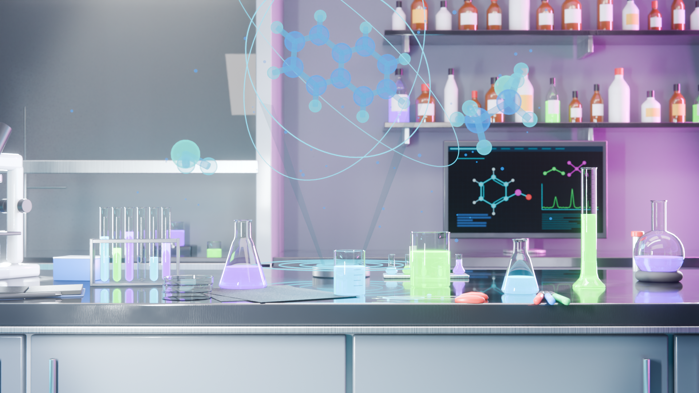

# Sci-Fi Chemistry Lab

A realistic sci-fi chemistry lab scene built in **Blender 5.2** and rendered with **Cycles**.
Most of the scene was built procedurally with Blender's Python API.

## What's in the scene
- **Lab:** a 6 x 5 m room with a dark epoxy bench, fume hood, wall shelves of reagent bottles, and a monitor showing molecular structures
- **Glassware:** beakers, conical flasks, test tubes in a rack, a round-bottom flask, and a graduated cylinder, all at real-world scale
- **Liquids:** cyan, green and purple, with meniscus and uneven fill levels
- **Holograms:** floating ball-and-stick molecules with scan lines, orbit rings and particles
- **Details:** microscope, notebook, pipettes, spills, markers and other bench clutter

## Technical highlights
- **Glass:** Principled BSDF with full transmission, IOR 1.45, Solidify and Bevel modifiers for thin walls
- **Liquids:** separate meshes inside the glass with IOR 1.33 and volume absorption for color
- **Bench:** glossy epoxy with noise-driven roughness variation and smudge maps
- **Metal:** brushed steel with anisotropic reflections
- **Holograms:** emission shaders mixed with a Fresnel/transparent blend
- **Lighting:** cool-white ceiling panels, cyan and magenta rim lights, a low-strength HDRI, light volumetric fog
- **Render:** Cycles with OpenImageDenoise, 1920 x 1080, AgX (Medium High Contrast)
- **Compositor:** bloom, vignette, subtle chromatic aberration and film grain

## How to open it
1. Install [Blender 5.2](https://www.blender.org/download/) or newer.
2. Download `sci_fi_chem_lab.blend` and open it.
3. Press **F12** to render. A CPU render takes roughly an hour on a laptop.

## Tools
Blender 5.2, Cycles, Python (bpy)